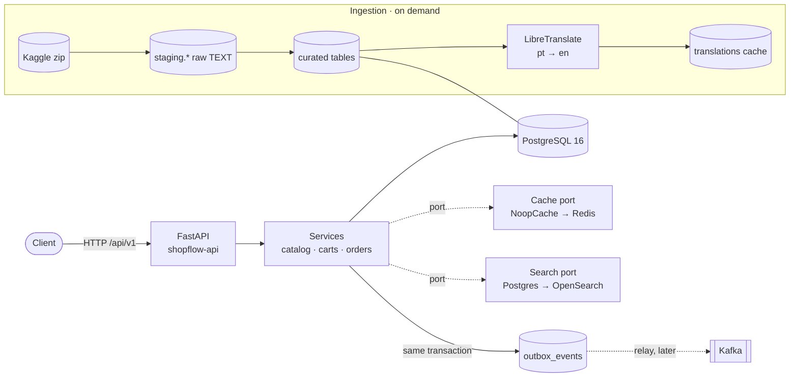
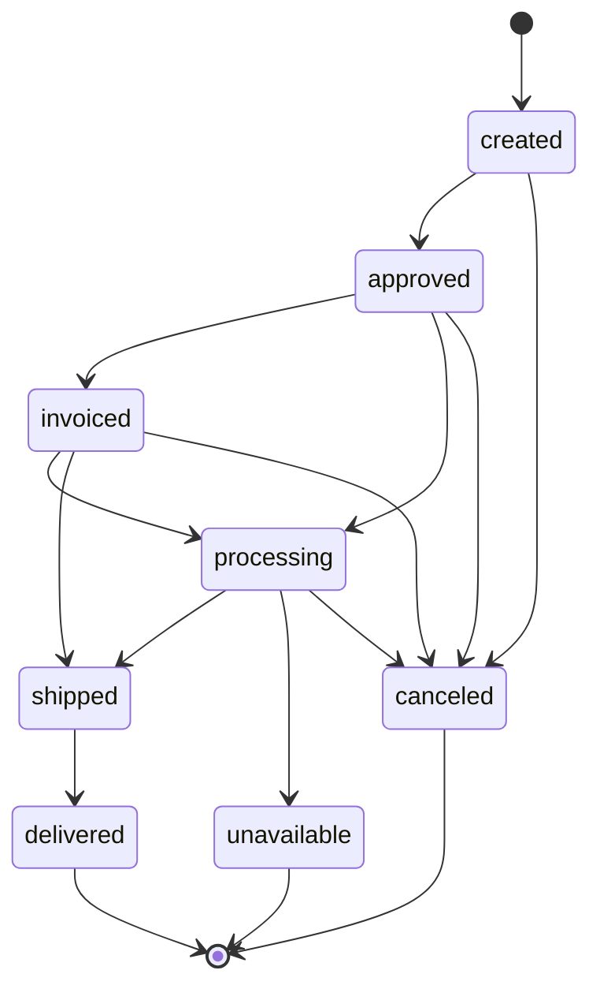
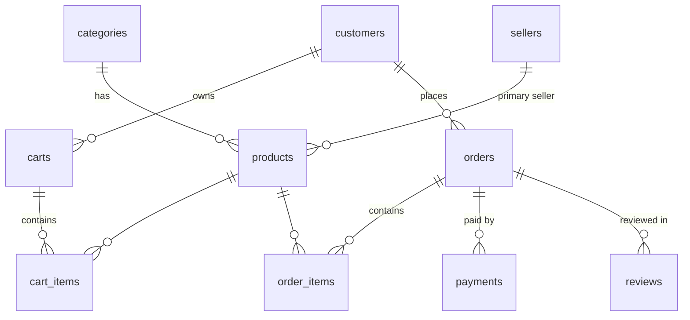

# Architecture

## Phase 1 at a glance



Dotted lines are seams that exist today as interfaces and get real adapters in later
phases. Nothing above the service layer changes when they do.

## Layers

| Layer | Responsibility | Rule |
|---|---|---|
| `api/` | HTTP: routing, validation, status codes, headers, request IDs | No SQL, no business rules |
| `services/` | Business logic and transactions | No FastAPI imports; raises `DomainError`s |
| `domain/` | ORM models (storage) and Pydantic schemas (wire) | Kept separate so either can change alone |
| `ports/` | Cache, search and events behind small interfaces | Adapters wired once, in `api/main.py` lifespan |
| `ingest/` | Batch pipeline, runs outside the API process | Idempotent and resumable |

Domain errors map to one JSON error shape in a single exception handler, so services stay
testable without HTTP.

## The checkout path (one order through the stack)

`POST /api/v1/orders` with `Idempotency-Key` runs **one database transaction**:

1. **Claim the idempotency key.** `INSERT ... ON CONFLICT DO NOTHING` into
   `idempotency_keys`. If the key exists with the same request hash, return the original
   order (`200`, `Idempotent-Replayed: true`). A different request under the same key is a
   `409`. A concurrent duplicate blocks on the unique index until the first commits, then
   replays, so five simultaneous retries produce exactly one order (tested).
2. **Lock the cart** with `SELECT ... FOR UPDATE` and check it is open and non-empty.
3. **Reserve stock** with a conditional update per product, in product-id order to avoid
   deadlocks:
   `UPDATE products SET stock = stock - :q WHERE id = :id AND stock >= :q RETURNING price`.
   No row back means out of stock and the whole transaction rolls back. There's no
   read-then-write race, so there's no overselling under concurrency (tested). A
   `CHECK (stock >= 0)` constraint is the backstop.
4. **Freeze prices** onto `order_items`. Carts always show live prices; the order records
   what was actually charged.
5. **Close the cart**, record the order id on the idempotency key, and **write an
   `order.created` row to `outbox_events`**.
6. Commit, then invalidate cache keys for the touched products.

Any failure rolls back everything, including the key claim, so a client can retry safely.

### Why a transactional outbox

Publishing to Kafka directly from the request has a dual-write problem: the DB commit can
succeed and the publish fail, or the other way round. Writing the event to a table in the
same transaction makes "state changed" and "event exists" atomic. A relay (queue phase)
reads unpublished rows in id order, publishes, and stamps `published_at`. Delivery is
at-least-once, so consumers dedupe on the event id.

### Order state machine



The statuses are Olist's own, so historical and new orders share one model. Cancelling
before shipment returns reserved stock. Each transition emits `order.<status>` to the
outbox. Transitions are enforced in `services/orders.py`.

## Data model



Plus `translations` (content-addressed translation cache), `idempotency_keys` and
`outbox_events`. See [DATA.md](DATA.md) for how Olist maps onto this.

Decisions worth knowing:

- **Money** is `NUMERIC(12,2)` and `Decimal` end to end, serialised as strings in JSON,
  so values are exact.
- **Timestamps** are `timestamptz`. Olist's local Brazil times are converted from
  `America/Sao_Paulo` during load.
- **`products.version`** is bumped on every stock change. The Redis phase uses it for
  cache keys and ETags.
- **Indexes** match the read paths: `(category_slug, price)` for browsing,
  `(customer_id, purchased_at)` for order history, `order_items(product_id)` for product
  reviews, and a partial index on unpublished outbox rows for the relay.

## Ingestion pipeline

```
download  ->  staging.* (raw CSV, every column TEXT)  ->  curated tables  ->  translate
```

- **Staging is schema-on-read.** CSVs are loaded byte for byte with `COPY`, so a bad row
  never fails the load, and the raw data stays queryable for the ML phase (for example
  `staging.geolocation`, which the API doesn't use).
- **Transforms are SQL** (`INSERT ... SELECT ... ON CONFLICT DO NOTHING`), run in one
  transaction and safe to re-run. Re-running never duplicates rows and never resets stock
  the API has changed.
- **Translation** collects distinct untranslated strings, translates them in batches with
  bounded concurrency and retries, and checkpoints every batch into `translations`, keyed
  by `sha256(text)`. Olist repeats a lot of short reviews ("Recomendo", "Muito bom"), so
  each distinct string is translated once. A crash loses at most one batch. Backends sit
  behind a two-method interface: LibreTranslate today, an LLM backend in the AI phase.
- **Category names** come from Olist's `product_category_name_translation.csv`. The two
  categories missing from that file get explicit overrides.

## Operational basics already in place

- Twelve-factor config from env vars (`core/config.py`), with `.env` for local use only
- JSON logs with a request id per line; `x-request-id` is honoured or generated and
  echoed back, ready for trace correlation
- `/healthz` (liveness) and `/readyz` (DB check) for Kubernetes probes
- Non-root, multi-stage Docker image with a healthcheck
- Migrations run as a one-shot `migrate` service that the API waits on, the same pattern
  as a Kubernetes Job or Helm pre-upgrade hook
- Integration tests against real Postgres, covering idempotency races and overselling

## Known simplifications (on purpose, for now)

- **No auth.** `customer_id` is passed in the request. An auth phase adds JWTs and
  ownership checks.
- **Synthetic stock.** Olist has no inventory data, so every product starts at
  `DEFAULT_STOCK`.
- **One price per product.** The price is the median Olist sale price, sold by the
  product's most frequent seller. A real marketplace has per-seller offers.
- **No payments.** `PATCH /orders/{id}/status` stands in for the fulfilment and payment
  flow, which becomes event-driven in the queue phase.
- **Offset pagination.** Fine at this size. Keyset pagination comes with the search work.
